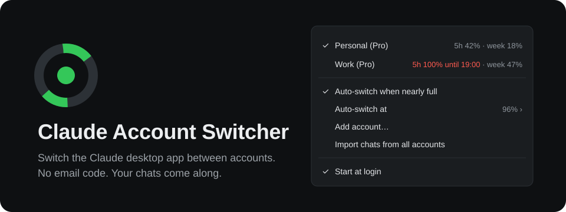
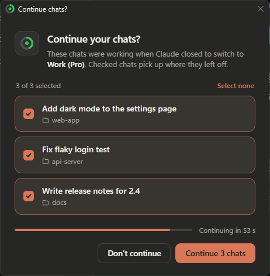

<div align="center">



[](https://github.com/SnlperStripes/claude-account-switcher/releases/latest)
[](https://github.com/SnlperStripes/claude-account-switcher/releases)
[](https://github.com/SnlperStripes/claude-account-switcher/actions/workflows/test.yml)
[](LICENSE)


**Hit your limit on one Claude account, keep working on the next one. One click, no email code.**

A tray tool for the Claude desktop app. It swaps the signed-in account in about ten seconds,
carries your Claude Code chats across, and shows the live usage of every account you own.

**Your sign-ins never leave your machine.** Tokens stay encrypted exactly as Claude stored them,
and the only server they ever go to is `api.anthropic.com`.

[](https://github.com/SnlperStripes/claude-account-switcher/releases/latest/download/claude-account-switcher-windows-amd64.exe)
[](https://github.com/SnlperStripes/claude-account-switcher/releases/latest/download/claude-account-switcher-macos)

Unofficial. Not affiliated with or endorsed by Anthropic.

</div>

---

## The problem

You have two Claude accounts because one runs out. Switching between them in the desktop app goes like this:

1. **Sign out.** That throws the sign-in away. Next time you need it, you start from zero.
2. **Sign in with the other address and wait for the email code.** With a private relay address, that means opening another app to find it.
3. **Find your work.** Claude files Claude Code chats per account, so the chat you were in the middle of is gone from the sidebar. The conversation still exists on disk; the app just does not list it.
4. **Guess** which account has room left, because usage only shows for the one you are signed in to.

Three of those four steps are pure overhead, and the fourth is a guess.

## What it does instead

**Keeps every sign-in.** Each account's sign-in is saved when you switch away from it and put back when you switch to it. You type an email code once per account, ever, and not again until Anthropic ends that sign-in.

**Switches in one click.** Right-click the tray icon, pick an account. Claude quits, the sign-in is swapped, Claude starts again. Everything else in Claude's settings stays exactly as it was.

**Brings your chats along.** Before Claude starts, the switcher copies the chat list entries of your other accounts into the one you switch to. Open the chat you were in and keep going. Projects come along too, so chats stay grouped in them. Chats you deleted stay deleted.

**Picks up where Claude stopped.** A switch restarts Claude, and a chat that was working at that moment would just stand still. The switcher notices which chats were in the middle of a reply and asks in a small window which of them should go on. Claude then continues the checked ones on the new account by itself.

**Shows usage for all accounts at once.** 5-hour and weekly usage for every saved account, live, with when each limit resets. A future 5-hour reset is shown even below the switch threshold, for example `5h 20%, resets 21:20`. At or above the threshold it reads `5h 98% until 21:20`. Times use a 24-hour clock in your local timezone. The tray icon is a ring that fills with the active account's 5-hour usage: green, orange from 75%, red at your switch threshold.

**Can switch on its own.** Off by default. Turn it on and the switcher moves Claude to the account with the most room left once the active one passes 96% (or 90, 94, 98, your choice). A second toggle moves it to an account whose weekly limit is about to reset mostly unused, so that usage is not lost.

## Measured

The first real run, on Windows 11 with the Microsoft Store version of Claude, from the switcher's own log:

| Step | Time |
| --- | --- |
| Add a second account, including typing its email code | 44 s |
| Detect the new sign-in, import the missing chats, restart Claude | 9 s |
| Switch accounts, from the click until Claude starts again | 9 s |
| Round trip of Claude's real `config.json` through the switcher | byte-identical |

## Install

Download the file for your platform and run it. No installer, no runtime, one file.

- **Windows 10/11:** [`claude-account-switcher-windows-amd64.exe`](https://github.com/SnlperStripes/claude-account-switcher/releases/latest/download/claude-account-switcher-windows-amd64.exe). Works with the Microsoft Store app and the direct download. Or install it with winget and start it with `claude-account-switcher`:
  ```
  winget install SnlperStripes.ClaudeAccountSwitcher
  ```
- **macOS:** [`claude-account-switcher-macos`](https://github.com/SnlperStripes/claude-account-switcher/releases/latest/download/claude-account-switcher-macos) (universal). The first start asks once whether it may read "Claude Safe Storage" from your keychain; that is the key Claude uses to encrypt its sign-in. Builds in CI, not yet tested on a real Mac. Reports welcome.
- **Linux:** there is no official Claude desktop app, so there is nothing to switch.

Then turn on **Start at login** in its menu.

The builds are not code-signed, so the first start gets one warning:

- **Windows:** SmartScreen says "Windows protected your PC". Click **More info**, then **Run anyway**.
- **macOS:** the download is not executable yet and Gatekeeper blocks it. Run this once in the folder you saved it to:
  ```bash
  chmod +x claude-account-switcher-macos && xattr -d com.apple.quarantine claude-account-switcher-macos
  ```

Every download has a `.sha256` file next to it, so you can check it is the file CI built.

## First run

1. Start the switcher while you are signed in to Claude. It picks up that account within a minute.
2. Choose **Add account…**. Claude restarts on its sign-in screen. Your first account is kept.
3. Sign in with the second account. The switcher notices, restarts Claude once more, and the chats of your other account show up.

From then on, click an account to switch.

> [!IMPORTANT]
> **Never use Sign out in Claude to change accounts.** Signing out can end that sign-in on Anthropic's side, and the switcher's saved copy stops working. The account then shows "signed out, add it again". Use **Add account…** to sign it in once more.

## Auto-switch

Two toggles in the menu, both off until you turn them on:

- **Auto-switch** moves Claude to the account with the most room left once the active one is nearly full.
- **Auto-switch to use up expiring weekly** moves Claude to an account whose weekly limit resets soon with most of it unused, so that usage is not lost.

A switch restarts Claude. A reply that is being written at that moment stops, and Claude picks it up again on the other account, see [Chats that were working](#chats-that-were-working).

Anthropic's terms do not forbid having more than one account. They do forbid "bypassing any of our systems or protective measures". Whether automatic switching fits how you use your accounts is your call, which is why both toggles are off until you turn them on.

<details>
<summary><b>When Auto-switch acts</b></summary>

&nbsp;

All of these have to hold before the switcher acts:

| Rule | Why |
| --- | --- |
| The active account is at or above the threshold, 5-hour or weekly | 96% by default, so the switch lands before a reply gets cut off at 100% |
| Another account is at least 10 points below the threshold | No bouncing onto an account that is nearly full too |
| The active account was checked in the last 5 minutes, the other one in the last 15 | No decisions on stale numbers |
| The last switch was more than 10 minutes ago | No ping-pong |
| Claude is running | It never starts Claude behind your back |

</details>

<details>
<summary><b>When Auto-switch to use up expiring weekly acts</b></summary>

&nbsp;

Weekly usage you do not spend before the reset is gone. With this on, the switcher moves Claude to another account when all of these hold:

| Rule | Why |
| --- | --- |
| The other account's weekly limit resets within 24 hours | That is the usage about to be lost |
| It has used 50% of its week or less | Worth a restart only when a good part is left |
| It is at least 10 points below the threshold, 5-hour included | It can actually take work right now |
| The active account is not in the same spot itself, resetting within 24 hours at 50% or less | Its own unused week counts just as much |
| You did not switch by hand in the last 5 hours | Your own pick wins |
| No Claude Code chat was active in the last 15 minutes | This switch is never urgent, so it waits instead of cutting off a reply |

The freshness, cooldown and "Claude is running" rules above apply too. When several accounts qualify, the one that resets first wins. With both toggles on, being nearly full comes first: the account with the most room wins over the one that resets first.

Once it has moved to an account, it keeps using that week until the reset, even after more than half of it is used. If that account's 5-hour limit fills up and the normal auto-switch moves away, it comes back once the 5-hour window resets. Switching by hand ends this.

After any automatic switch, from either toggle, the top of the menu says why for 12 hours, for example "Auto-switched at 03:12 to use up this account's week before it resets 18:00".

</details>

## Chats that were working

Claude has to quit for a switch, so every Claude Code chat that is writing a reply or running a tool stops. Before Claude starts again, a window lists those chats:



- Each chat shows its title and project folder, all checked.
- **Continue** lets Claude carry on with the checked ones. **Don't continue**, Escape or closing the window leaves all of them where they stopped.
- Nobody answering means all of them go on after 30 seconds, so an automatic switch at night does not leave work standing. Touching a checkbox stops the countdown.

When Claude is back, it sends each checked chat "The app was quit while you were working. Please continue from where you left off." and the chat goes on in the account you switched to. That is Claude's own way of continuing after a restart; the switcher only tells it which chats to continue.

<details>
<summary><b>How the switcher knows which chats were working</b></summary>

&nbsp;

Right before Claude quits, the switcher reads the end of every Claude Code conversation written to in the last 30 minutes. A chat counts as working when its last message is a prompt or tool result Claude has not answered yet, or a tool call. A finished reply or a reply you stopped yourself does not count.

For each chat you keep checked, the switcher writes the mark Claude itself leaves when it quits during a reply (`interruptedByQuitAt`) into that chat's entry of the account you switch to, and removes the mark from the other accounts' copies, so the chat is not continued twice. Claude continues marked chats for 24 hours after the restart; a chat it cannot reach in that time simply stays where it stopped.

On Windows the window is drawn with WebView2, which comes with Windows 11 and current Windows 10. Without it, a plain Windows dialog asks the same question. On macOS it uses WebKit; like the rest of the macOS build, this has not been tested on a real Mac yet.

</details>

## How it works

The switcher saves and restores the sign-in of each account, copies the chat list and projects between accounts, and reads usage from `api.anthropic.com`. It backs up Claude's files before every switch and leaves the rest of Claude's settings alone.

<details>
<summary><b>Which files, and what happens to them</b></summary>

&nbsp;

Claude keeps its sign-in in two places inside its data folder:

| Platform | Data folder |
| --- | --- |
| Windows, Microsoft Store app | `%LOCALAPPDATA%\Claude-Data\claude_<id>` since 2.42304, before that `%LOCALAPPDATA%\Packages\Claude_<id>\LocalCache\Roaming\Claude` |
| Windows, direct download | `%APPDATA%\Claude` |
| macOS | `~/Library/Application Support/Claude` |

| What | Where | What the switcher does with it |
| --- | --- | --- |
| Sign-in tokens | `config.json`: `oauth:tokenCacheV2`, `oauth:tokenCache`, `lastKnownAccountUuid` | Saves and restores these three entries, leaves every other entry untouched |
| Web session | `Network/Cookies` | Saves and restores the file while Claude is closed |
| Chat list | `claude-code-sessions/<account>/<organization>/local_<id>.json` | Copies missing entries in, refreshes older ones, never deletes |
| Deleted chats | `deleted_<id>` next to the entries | Reads them, so a deleted chat is never copied back |
| Projects | `local-agent-mode-sessions/<account>/<organization>/spaces.json` | Adds missing projects, refreshes older ones, never deletes. Leaves out the claude.ai project link of the other organization, and a project you deleted in an account is not copied back |
| Chats stopped by a switch | `interruptedByQuitAt` in their `local_<id>.json` | Sets Claude's own quit mark on the chats you chose to continue, removes it from the other accounts' copies and from chats you unchecked |
| Conversations | `~/.claude/projects` | Reads the end of the ones written to in the last 30 minutes to see which chats are mid-reply. Never writes. They are shared by all accounts already |

**Quitting Claude.** On Windows the switcher tells Claude's windows that Windows is closing the app, the way an installer does, and Claude quits within a second or two. A plain close request would only hide Claude in the tray. If Claude is still running after 20 seconds, it is ended.

Before each switch, `config.json` and the cookie store are backed up. The last 10 backups are kept. If any step fails, the backup goes back and the error shows at the top of the menu.

**Usage.** The saved token cache is decrypted in memory with Claude's own key (DPAPI on Windows, the keychain on macOS). The switcher then asks `api.anthropic.com` for each account's profile and usage, the same endpoints Claude and Claude Code use themselves. The active account is checked every two minutes, every minute from 85%, the others every ten. That endpoint is rate-limited per account and Claude polls it too, so after a `429` the switcher waits as long as the server asks, or backs off up to 30 minutes, and keeps showing the last numbers meanwhile. Claude's tokens last about a month, so a saved account keeps showing live usage without being signed in.

**Updates.** Once a day the switcher asks GitHub for the version number of the latest release. Nothing about you or your accounts goes along. When a newer version is out, the top of the menu says so. A click downloads it from the GitHub release, checks it against the published SHA-256, puts it in place of the running file and restarts on it. A download the switcher makes itself gets no SmartScreen or Gatekeeper warning. If that fails, the download page opens instead. Starting a newer version by hand also works: it asks the running one to quit and takes over. With winget, `winget upgrade SnlperStripes.ClaudeAccountSwitcher` does the same. To never contact GitHub, quit the switcher, add `"noUpdateCheck": true` to `state.json` and start it again.

**The Store app quirk.** Programs started from inside the Store version of Claude, a Claude Code terminal for example, see a redirected AppData folder. The switcher notices when it was started that way and starts itself again through Explorer, so it sees the real files and survives Claude quitting.

</details>

## Your data

| | |
| --- | --- |
| Saved sign-ins, state, backups, log | `~/.claude-account-switcher` (`%USERPROFILE%\.claude-account-switcher` on Windows), **Open data folder** in the menu. On Windows, `webview` in there is the WebView2 profile of the window that asks which chats continue |
| Tokens | Stored exactly as Claude encrypted them. Never written in plain text, never sent anywhere but `api.anthropic.com` |
| Network | `api.anthropic.com` for profiles and usage. `api.github.com` once a day for the latest version number, off with `"noUpdateCheck": true` in `state.json`. `github.com` only when you click to update |
| Remove an account | Quit the switcher, delete its folder under `accounts/` and its entry in `state.json` |
| Uninstall | Turn off **Start at login**, quit, delete the binary and the data folder |

## Command line

```
claude-account-switcher -status
```

Prints every saved account with its usage and exits.

## Build

Go 1.26 or newer.

```bash
go test ./...
go build -ldflags "-H=windowsgui -s -w" -o claude-account-switcher.exe .   # Windows
CGO_ENABLED=1 go build -o claude-account-switcher .                        # macOS
```

Dependencies beyond the standard library: [`fyne.io/systray`](https://github.com/fyne-io/systray) for the tray icon, and for the window that asks which chats continue [`jchv/go-webview2`](https://github.com/jchv/go-webview2) on Windows and [`webview/webview_go`](https://github.com/webview/webview_go) on macOS. On Windows also `golang.org/x/sys`.

## FAQ

**Can the Claude desktop app be signed in to two accounts at once?**
Not on its own. The app holds one sign-in at a time, and switching means signing out and waiting for an email code. The switcher keeps a saved sign-in for every account and swaps between them in about ten seconds.

**How do I switch Claude accounts without signing out?**
Install the switcher, add each account once with **Add account…**, then pick an account from the tray menu. You never use Sign out again.

**What happens to my Claude Code chats when I switch accounts?**
They come along. The switcher copies the chat list and projects of your other accounts into the one you switch to, so the chat you were in shows up in the sidebar and you can keep going.

**What happens to a reply Claude is writing when I switch?**
It stops, because Claude has to restart. Before Claude starts again, the switcher asks which of the stopped chats should go on, and Claude continues those by itself on the new account. See [Chats that were working](#chats-that-were-working).

**How do I see the usage of all my Claude accounts at once?**
The tray menu shows 5-hour and weekly usage of every saved account, live, with when each limit resets. `claude-account-switcher -status` prints the same in a terminal.

**What can I do when I hit the Claude usage limit?**
Switch to an account that has room left, or let **Auto-switch** do it for you shortly before the limit.

**Does it work with the Microsoft Store version of Claude?**
Yes. It finds the Store app's real data folder and works with the direct download too. Windows 10 and 11.

**Does it work on macOS?**
It builds for macOS (universal) in CI, but nobody has tested it on a real Mac yet. A [test report](https://github.com/SnlperStripes/claude-account-switcher/issues/new?template=macos_report.yml) helps.

**Does it switch the Claude Code CLI in the terminal?**
No. This switches the Claude desktop app, including the Claude Code chats inside it. The `claude` command in a terminal keeps its own sign-in, and the switcher does not touch it.

**Do my sign-ins leave my machine?**
No. Tokens stay encrypted exactly as Claude stored them, and the only server they ever go to is `api.anthropic.com`. The only other request is a daily check on GitHub for a new version, which sends nothing about you and can be turned off, see [How it works](#how-it-works).

**How do I update?**
The menu says so when a new version is out; click it and the switcher updates itself and restarts. Or download the new file and start it, it replaces the running one. With winget, run `winget upgrade SnlperStripes.ClaudeAccountSwitcher`. Your accounts and settings stay in the data folder.

## Caveats

This relies on how the Claude desktop app stores its files today, not on a published interface. An app update can change that. When it does, the switcher fails loudly, restores its backup and says so in the menu. It does not guess.

## Contributing

Bug reports, ideas and pull requests are welcome, see [CONTRIBUTING.md](CONTRIBUTING.md).
Got a Mac? A [macOS test report](https://github.com/SnlperStripes/claude-account-switcher/issues/new?template=macos_report.yml) helps a lot, even if everything just worked.
Found a security problem? Please report it privately, see [SECURITY.md](SECURITY.md).
If the switcher saves you time, a star helps other people with more than one account find it.

## License

[Apache 2.0](LICENSE). Use it, change it, ship it, sell it.

**Keep the credit.** If you pass this on, changed or not, include the [`NOTICE`](NOTICE) file, which names the author and links back here, and say what you changed.
