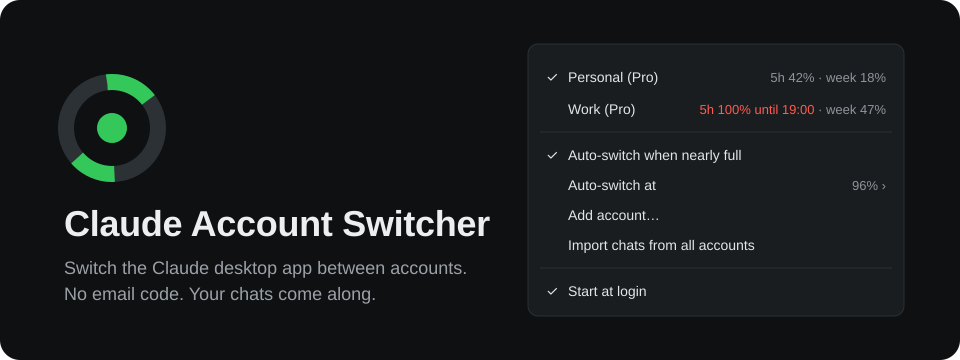
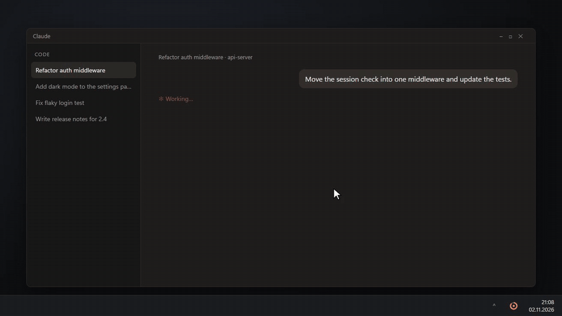

<div align="center">

[English](README.md) | 简体中文



[](https://github.com/SnlperStripes/claude-account-switcher/releases/latest)
[](https://github.com/SnlperStripes/claude-account-switcher/releases)
[](https://github.com/SnlperStripes/claude-account-switcher/actions/workflows/test.yml)
[](LICENSE)


**一个 Claude 账号的额度用完了，就切到下一个继续工作。一键切换，无需邮箱验证码。**

这是一个为 Claude 桌面应用提供账号切换功能的系统托盘工具。它可以在约十秒内切换登录账号，让切换后的账号继续看到 Claude Code 聊天，并同时显示所有账号的用量。

**登录凭证保存在本机。** Token 保留 Claude 原有的加密形式，只会发送到 `api.anthropic.com`。

[](https://github.com/SnlperStripes/claude-account-switcher/releases/latest/download/claude-account-switcher-windows-amd64.exe)
[](https://github.com/SnlperStripes/claude-account-switcher/releases/latest/download/claude-account-switcher-macos)



本项目为非官方工具，与 Anthropic 无隶属关系，也未获得其认可。

</div>

---

## 它解决什么问题

当你拥有两个 Claude 账号，而其中一个额度用完时，在桌面应用中手动切换通常需要：

1. **退出登录。** 原有登录状态会因此失效，下次还要从头登录。
2. **输入另一个邮箱并等待验证码。** 如果使用隐私转发邮箱，还可能需要打开其他应用查找邮件。
3. **重新找到正在进行的工作。** Claude 按账号保存 Claude Code 聊天列表；聊天内容仍在本机磁盘上，但切换后侧边栏不再显示。
4. **猜测哪个账号还有剩余额度。** 应用只显示当前登录账号的用量。

这个工具把这些步骤整合到系统托盘菜单中。

## 主要功能

**保留各账号的登录状态。** 切换离开当前账号时保存登录状态，切回来时恢复。每个账号首次添加时需要验证码，之后只要登录凭证仍有效，就无需再次验证。

**一键切换。** 右键点击托盘图标，选择目标账号。Claude 退出、登录状态被替换，Claude 再重新启动。其他应用设置保持原样。

**聊天和项目随账号切换。** Claude 启动前，切换器把其他账号的聊天列表条目导入目标账号。打开之前的聊天即可继续。项目分组也会同步，已删除的聊天不会被重新导入。

**从 Claude 停下的地方继续。** 切换会重启 Claude，正在进行的聊天会停住。切换器会识别哪些聊天正在回复中，并在一个小窗口中询问哪些需要继续。Claude 随后会在新账号中自动继续勾选的聊天。

**同时查看所有账号的用量。** 菜单实时显示每个已保存账号的 5 小时用量和每周用量，以及各自的重置时间，例如 `5小时 20%，21:20 重置`。达到切换阈值后显示为 `5小时 98%，21:20 才重置`。时间使用 24 小时制和本地时区。托盘圆环随当前账号的 5 小时用量填充：通常为绿色，达到 75% 时变橙色，达到切换阈值时变红色。

**可选的自动切换。** 默认关闭。开启后，当前账号的用量超过 96% 时，自动切换到剩余额度最多的账号。阈值也可选 90%、94%、98%，或在“自定义…”中输入任意整数百分比。另一个开关会切换到周额度即将重置、但大部分尚未使用的账号，避免这部分额度浪费。

**中文界面。** Windows 或 macOS 的首选显示语言为简体中文时，菜单和窗口自动显示中文。详见[界面语言](#界面语言)。

## 实测结果

以下数据来自首次在 Windows 11、Microsoft Store 版 Claude 上运行时的日志：

| 操作 | 耗时或结果 |
| --- | --- |
| 添加第二个账号，包含输入邮箱验证码 | 44 秒 |
| 识别新登录、导入缺少的聊天、重启 Claude | 9 秒 |
| 点击切换账号，到 Claude 再次启动 | 9 秒 |
| 真实 `config.json` 经过读取再写回 | 字节完全一致 |

## 安装

下载适合你系统的文件并运行即可，无需安装运行时。

- **Windows 10/11：** 下载 [`claude-account-switcher-windows-amd64.exe`](https://github.com/SnlperStripes/claude-account-switcher/releases/latest/download/claude-account-switcher-windows-amd64.exe)。支持 Microsoft Store 版和直接下载安装的 Claude。也可以使用 winget 安装，之后通过 `claude-account-switcher` 启动：

  ```powershell
  winget install SnlperStripes.ClaudeAccountSwitcher
  ```

- **macOS：** 下载 [`claude-account-switcher-macos`](https://github.com/SnlperStripes/claude-account-switcher/releases/latest/download/claude-account-switcher-macos)，同时支持 Apple Silicon 和 Intel。首次运行会询问一次是否允许读取钥匙串中的“Claude Safe Storage”，这是 Claude 加密登录凭证所用的密钥。macOS 版已通过 CI 构建，但尚未在真实 Mac 上测试，欢迎反馈。
- **Linux：** 没有官方的 Claude 桌面应用，因此不支持。

启动后可在菜单中开启 **开机时启动**。程序没有主窗口；Windows 用户请在任务栏右下角的托盘区域查找圆环图标，必要时展开隐藏的图标。

发布文件没有代码签名，首次启动可能遇到系统提示：

- **Windows：** SmartScreen 可能显示“Windows 已保护你的电脑”，点击“更多信息”，再选择“仍要运行”。
- **macOS：** 下载的文件还没有执行权限，并受 Gatekeeper 限制。在文件所在目录执行一次：

  ```bash
  chmod +x claude-account-switcher-macos && xattr -d com.apple.quarantine claude-account-switcher-macos
  ```

每个发布文件旁都有对应的 `.sha256` 文件，可用于校验下载内容。

## 首次使用

1. 先在 Claude 桌面端登录，再启动切换器。它会在一分钟内识别当前账号。
2. 点击 **添加账号…**。切换器保存当前账号的登录状态，重启 Claude 并显示登录页面。
3. 登录第二个账号。切换器识别成功后会再次重启 Claude，以导入其他账号的聊天列表。

之后，点击托盘菜单中的账号即可切换。

> [!IMPORTANT]
> **切换账号时，请使用切换器，不要在 Claude 中点击“退出登录”。** 退出登录会让 Anthropic 撤销该凭证，切换器保存的副本也会随之失效。此时账号会显示“登录已失效，请重新添加”，需要通过“添加账号…”重新登录。

## 界面语言

菜单和窗口跟随系统的首选显示语言：简体中文（zh-CN、zh-SG、zh-Hans）显示中文，其他语言显示英文。日志始终为英文。

如果想固定使用某种语言，请退出切换器，在数据文件夹的 `state.json` 中加入 `"language": "zh-CN"` 或 `"language": "en"`，再启动程序。这个设置在更新和开机启动后依然有效。

## 自动切换

菜单中有两个开关，默认均关闭：

- **额度快用完时自动切换：** 当前账号快满时，切换到剩余额度最多的账号。
- **自动用掉即将重置的周额度：** 切换到周额度即将重置、但大部分尚未使用的账号，避免这部分额度浪费。

切换会重启 Claude。正在生成的回复会停住，Claude 会在另一个账号中继续，详见[切换时正在进行的聊天](#切换时正在进行的聊天)。

Anthropic 的条款并不禁止拥有多个账号，但禁止“绕过我们的任何系统或保护措施”。自动切换是否适合你使用账号的方式，需要你自己判断，因此两个开关都默认关闭。

<details>
<summary><b>额度快用完时，何时自动切换</b></summary>

必须同时满足以下条件：

| 条件 | 原因 |
| --- | --- |
| 当前账号的 5 小时或每周用量达到阈值 | 默认 96%，在达到 100% 前切换 |
| 候选账号的两项用量都低于“阈值减 10 个百分点” | 避免切到同样快满的账号；默认要求低于 86% |
| 当前账号的数据在最近 5 分钟内查询过，候选账号在最近 15 分钟内查询过 | 避免根据过时数据决策 |
| 距离上次切换至少 10 分钟 | 避免来回切换 |
| Claude 正在运行 | 自动切换不会打开已经关闭的 Claude |

候选账号按 `max(5 小时用量, 每周用量)` 比较，选择该值最低的账号。

</details>

<details>
<summary><b>自动用掉即将重置的周额度，何时切换</b></summary>

周额度重置后，上一周期未使用的额度不会保留。开启此功能后，还需满足：

| 条件 | 原因 |
| --- | --- |
| 其他账号的周额度将在 24 小时内重置 | 这是即将失效的额度 |
| 该账号的周用量不超过 50% | 剩余额度较多，值得切换 |
| 该账号的 5 小时和每周用量均低于“阈值减 10 个百分点” | 确保它当前确实可用 |
| 当前账号本身不属于同样即将重置且用量较低的情况 | 当前账号的剩余额度同样有价值 |
| 最近 5 小时内没有手动切换 | 尊重你自己的选择 |
| 最近 15 分钟内没有 Claude Code 聊天写入 | 这种切换不紧急，等空闲时再进行 |

上述数据新鲜度、冷却时间和 Claude 正在运行的要求同样适用。多个账号符合条件时，选择最早重置的账号。两个开关同时开启时，“额度快用完”的切换优先。

切换到某个账号以用掉其周额度后，程序会一直回到这个账号，直到它的周额度重置；即使用量随后超过 50% 也是如此。若其 5 小时额度用完，普通自动切换可以暂时离开，等 5 小时窗口重置后再返回。手动切换会结束这种状态。

每次自动切换后，菜单顶部会在 12 小时内显示原因，例如“已于 03:12 自动切换，在 18:00 重置前用掉此账号的周额度”。

</details>

## 切换时正在进行的聊天

Claude 必须退出才能切换，因此所有正在写回复或运行工具的 Claude Code 聊天都会停住。Claude 再次启动前，会弹出一个窗口列出这些聊天：

- 每个聊天显示标题和项目文件夹，默认全部勾选。
- **继续** 让 Claude 继续勾选的聊天。**不继续**、按 Esc 或关闭窗口则让它们全部停在原处。
- 如果 30 秒内无人回应，所有聊天都会继续，这样夜间的自动切换不会让工作停下。点击任意复选框会停止倒计时。

Claude 重新启动后，会向每个勾选的聊天发送“The app was quit while you were working. Please continue from where you left off.”，聊天随即在切换后的账号中继续。这是 Claude 自己在重启后继续工作的方式，切换器只负责告诉它要继续哪些聊天。

<details>
<summary><b>切换器如何知道哪些聊天正在进行</b></summary>

&nbsp;

就在 Claude 退出前，切换器读取最近 30 分钟内有写入的每个 Claude Code 对话的末尾。如果最后一条消息是 Claude 尚未回答的提问或工具结果，或者是一次工具调用，这个聊天就算正在进行。已完成的回复或你自己停止的回复不算。

对每个保持勾选的聊天，切换器会在目标账号的聊天条目中写入 Claude 自己在回复中途退出时留下的标记（`interruptedByQuitAt`），并从其他账号的副本中移除该标记，避免同一个聊天被继续两次。Claude 会在重启后 24 小时内继续带有标记的聊天；在此期间无法继续的聊天会停在原处。

在 Windows 上，这个窗口使用 WebView2 绘制，Windows 11 和较新的 Windows 10 已自带。没有 WebView2 时，会改用普通的 Windows 对话框询问同样的问题。在 macOS 上使用 WebKit；与 macOS 版的其他部分一样，尚未在真实 Mac 上测试。

</details>

## 终端中的 Claude Code

默认关闭。勾选“终端中的 Claude Code 也一起切换”后，每次切换（无论手动还是自动）都会把 `claude` 命令也切换到同一个账号，让桌面应用和终端始终使用同一个账号。目前仅支持 Windows 和 Linux：在 macOS 上，Claude Code 把登录信息保存在钥匙串中，切换器不会改动。

每个账号需要在 Claude Code 中登录一次：先把桌面应用切换到该账号，然后在 Claude Code 中运行 `/login`（或 `claude auth login`），用同一个账号登录。切换器会保存这份登录信息的副本，以后每次切换到该账号时自动放回。账号还没有副本时，菜单顶部会给出提示。

- 在 Claude Code 中更换账号时请直接使用 `/login`，不要先运行 `/logout`。`/logout` 会吊销登录，切换器保存的副本也会随之失效。
- 正在运行的 `claude` 会自行读取更换后的登录信息，无需重启。
- 如果 Claude Code 登录的是切换器中没有的账号，切换器不会改动它。
- `ANTHROPIC_API_KEY`、`CLAUDE_CODE_OAUTH_TOKEN` 以及 Claude Code 中优先级高于 `/login` 的其他凭证，会覆盖切换后的登录。
- 桌面应用内的 Code 标签页始终使用应用自己的账号，不需要这个选项。

## 工作原理

切换器保存和恢复各账号的登录状态，在账号之间复制聊天列表与项目分组，并从 `api.anthropic.com` 读取用量。每次切换前会备份 Claude 的相关文件，其他 Claude 设置保持原样。

<details>
<summary><b>会访问哪些文件，如何处理</b></summary>

Claude 的数据目录因系统和安装方式而异：

| 平台 | 数据目录 |
| --- | --- |
| Windows，Microsoft Store 版 | 从 2.42304 起为 `%LOCALAPPDATA%\Claude-Data\claude_<id>`；旧版为 `%LOCALAPPDATA%\Packages\Claude_<id>\LocalCache\Roaming\Claude` |
| Windows，直接下载安装 | `%APPDATA%\Claude` |
| macOS | `~/Library/Application Support/Claude` |

| 数据 | 位置 | 切换器的处理方式 |
| --- | --- | --- |
| 登录 Token | `config.json` 中的 `oauth:tokenCacheV2`、`oauth:tokenCache`、`lastKnownAccountUuid` | 保存和恢复这三个字段，其他字段不动 |
| 网页登录会话 | `Network/Cookies`，部分版本位于数据目录根部 | Claude 关闭后保存和恢复该文件及其 journal 文件 |
| 聊天列表 | `claude-code-sessions/<account>/<organization>/local_<id>.json` | 补充缺失条目，更新较旧的条目，从不删除 |
| 已删除聊天 | 条目旁的 `deleted_<id>` | 读取这些标记，已删除的聊天不会被重新导入 |
| 项目分组 | `local-agent-mode-sessions/<account>/<organization>/spaces.json` | 添加缺失项目、更新较旧的项目，从不删除。不复制另一个组织的 claude.ai 项目链接，在某个账号中删除的项目也不会被复制回来 |
| 因切换而停住的聊天 | 其 `local_<id>.json` 中的 `interruptedByQuitAt` | 为你选择继续的聊天写入 Claude 自己的退出标记，并从其他账号的副本和你取消勾选的聊天中移除 |
| 聊天正文 | `~/.claude/projects` | 读取最近 30 分钟内有写入的对话末尾，判断哪些聊天正在回复中。从不写入。这些内容本来就由所有账号共享 |
| Claude Code 登录信息（仅在开启终端选项时） | `~/.claude/.credentials.json` 中的 `claudeAiOauth` 及该 claude.ai 账号的其他字段；`~/.claude.json` 中的 `oauthAccount`。设置了 `CLAUDE_CONFIG_DIR` 时，两个文件都位于该目录中 | 把当前字段复制到切换器的文件夹，放入新账号已保存的字段，并像 `/login` 一样清除该文件中与账号相关的缓存。操作期间持有 Claude Code 自己刷新 Token 时使用的锁。MCP 服务器的 Token 和其他字段保持不动。两次切换之间只读取这些文件，用来保持当前登录账号的副本为最新 |

**退出 Claude。** 在 Windows 上，切换器像安装程序那样通知 Claude 的窗口“Windows 正在关闭此应用”，Claude 会在一两秒内退出。普通的关闭请求只会把 Claude 隐藏到托盘。如果 20 秒后 Claude 仍在运行，会被强制结束。

每次切换前会备份 `config.json` 和 Cookie 存储，保留最近 10 份。任何一步失败时都会恢复备份，并在菜单顶部显示错误。开启终端选项后，Claude Code 的两个文件在改动前会备份到 `cli-backups`，保留最近 10 份；替换失败时会把改动过的内容放回原样。

**用量。** 程序使用 Claude 自己的密钥在内存中解密已保存的 Token 缓存：Windows 使用 DPAPI，macOS 使用钥匙串。随后请求账号信息和用量接口。当前账号每两分钟查询一次，达到 85% 后每分钟一次；其他账号每十分钟一次。接口按账号限流，而 Claude 本身也会轮询，因此收到 `429` 后会按服务器要求等待，或逐步退避，最长 30 分钟。等待期间保留最近的结果。Claude 的 Token 大约可用一个月，因此已保存但未登录的账号也能持续显示实时用量。

**更新。** 程序每天向 GitHub 查询一次最新版本号，不附带任何账号信息。有新版本时，菜单顶部会提示；点击后会下载文件、核对发布的 SHA-256 校验值、替换当前程序并重新启动。切换器自己下载的文件不会触发 SmartScreen 或 Gatekeeper 警告。失败时会打开下载页面。直接启动新下载的版本也可以：它会等旧版本完成正在进行的切换后接管。winget 用户可运行 `winget upgrade SnlperStripes.ClaudeAccountSwitcher`。若要关闭查询，请退出切换器，在 `state.json` 中加入 `"noUpdateCheck": true`，再启动程序。

**Store 版的路径重定向。** 从 Store 版 Claude 内启动的程序，例如 Claude Code 终端，会看到重定向后的 AppData 目录。切换器会检测这种情况，必要时通过 Explorer 重新启动自身，以访问真实文件，并且不会随 Claude 一起退出。

</details>

## 你的数据

| 项目 | 说明 |
| --- | --- |
| 已保存的登录、状态、备份和日志 | 位于 `~/.claude-account-switcher`（Windows 为 `%USERPROFILE%\.claude-account-switcher`），可通过菜单中的“打开数据文件夹”进入。在 Windows 上，其中的 `webview` 是询问继续哪些聊天的窗口所用的 WebView2 配置 |
| Token | 桌面应用的 Token 按 Claude 原有加密形式保存，从不写成明文，只发送到 `api.anthropic.com` |
| Claude Code 的 Token（仅在开启终端选项时） | 按 Claude Code 在 Windows 和 Linux 上自己的方式保存：只有你的用户可读的明文 JSON，位于 `accounts/<id>/cli.json` 和 `cli-backups`。切换器从不发送、也从不刷新它们。关闭该选项即停止这一切；删除这些文件即可移除副本 |
| 网络访问 | `api.anthropic.com` 用于账号信息和用量。`api.github.com` 每天一次用于查询最新版本号，可在 `state.json` 中用 `"noUpdateCheck": true` 关闭。只有点击更新时才会访问 `github.com` |
| 移除账号 | 退出切换器，删除 `accounts/` 下对应的文件夹，以及 `state.json` 中的对应条目 |
| 卸载 | 关闭“开机时启动”，退出程序，删除可执行文件和数据文件夹 |

## 命令行

```powershell
claude-account-switcher -status
```

打印所有已保存账号及其用量，然后退出。

## 构建

需要 Go 1.26 或更新版本。

```bash
go vet ./...
go test ./...
go build -ldflags "-H=windowsgui -s -w" -o claude-account-switcher.exe .   # Windows
CGO_ENABLED=1 go build -o claude-account-switcher .                        # macOS
```

标准库之外的依赖：[`fyne.io/systray`](https://github.com/fyne-io/systray) 提供托盘图标；询问继续哪些聊天的窗口在 Windows 上使用 [`jchv/go-webview2`](https://github.com/jchv/go-webview2)，在 macOS 上使用 [`webview/webview_go`](https://github.com/webview/webview_go)。Windows 还使用 `golang.org/x/sys`。

## 常见问题

**Claude 桌面端能同时登录两个账号吗？**
桌面端一次只能使用一个账号。这个工具保存每个账号的登录状态，并在约十秒内切换，无需验证码。

**如何不退出登录就切换账号？**
安装切换器，通过“添加账号…”分别添加每个账号一次，之后从托盘菜单选择账号即可。

**切换后，Claude Code 聊天会怎样？**
它们会一起过来。切换器把其他账号的聊天列表和项目分组导入目标账号，你之前的聊天会出现在侧边栏中，可以继续进行。

**切换时 Claude 正在写的回复会怎样？**
回复会停住，因为 Claude 必须重启。Claude 再次启动前，切换器会询问哪些停住的聊天需要继续，Claude 会在新账号中自动继续它们。详见[切换时正在进行的聊天](#切换时正在进行的聊天)。

**如何同时查看所有账号的用量？**
托盘菜单实时显示每个已保存账号的 5 小时和每周用量，以及各自的重置时间。`claude-account-switcher -status` 会在终端打印同样的内容。

**达到 Claude 用量限制后怎么办？**
切换到还有额度的账号，或开启“额度快用完时自动切换”。

**支持 Microsoft Store 版 Claude 吗？**
支持。程序会找到 Store 版的实际数据目录，也支持直接下载安装的版本，适用于 Windows 10 和 11。

**支持 macOS 吗？**
macOS 通用版本已通过 CI 构建，但尚未在真实 Mac 上测试。欢迎提交 [macOS 测试报告](https://github.com/SnlperStripes/claude-account-switcher/issues/new?template=macos_report.yml)。

**会切换终端中的 Claude Code CLI 账号吗？**
开启后会，支持 Windows 和 Linux。勾选“终端中的 Claude Code 也一起切换”后，每次切换都会把 `claude` 命令也切换到同一个账号，让桌面应用和终端始终使用同一个账号。该选项默认关闭，每个账号需要先在终端中运行一次 `/login`，详见[终端中的 Claude Code](#终端中的-claude-code)。macOS 暂不支持。

**登录凭证会上传到其他地方吗？**
不会。Token 保持 Claude 和 Claude Code 原有的存储方式，只发送到 `api.anthropic.com`。另有每天一次、不附带账号信息的 GitHub 版本查询，可以关闭，详见“工作原理”。

**如何更新？**
有新版本时，点击菜单顶部的提示即可下载、校验并以新版本重启。也可以直接运行新下载的版本，由它接管正在运行的旧版本。winget 用户可运行 `winget upgrade SnlperStripes.ClaudeAccountSwitcher`。账号和设置保存在独立的数据文件夹中，不受影响。

## 使用限制

本项目依赖 Claude 当前的本地文件存储方式，而不是公开的接口。Claude 更新可能改变数据路径、配置结构或加密格式。遇到无法处理的格式时，程序会报告错误并恢复备份。

## 参与贡献

欢迎提交问题反馈、建议和 Pull Request，详见 [CONTRIBUTING.md](CONTRIBUTING.md)。

如果你有 Mac，欢迎提交 [macOS 测试报告](https://github.com/SnlperStripes/claude-account-switcher/issues/new?template=macos_report.yml)，运行正常的反馈也很有帮助。

发现安全问题时，请按 [SECURITY.md](SECURITY.md) 的说明私下报告。

如果这个工具帮你节省了时间，点一个 Star 能帮助其他有多个账号的人找到它。

中文界面和文档由 [@50kg](https://github.com/50kg) 首先翻译。

## 许可证

[Apache 2.0](LICENSE)。可以随意使用、修改、发布和出售。

**请保留作者署名。** 分发原版或修改版时，请包含 [`NOTICE`](NOTICE) 文件，保留作者及项目链接，并说明所做修改。
