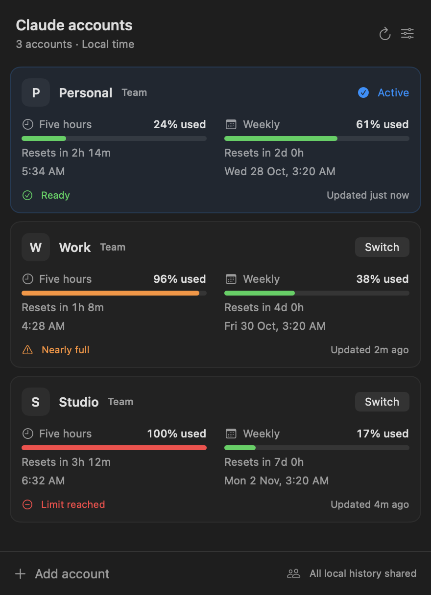
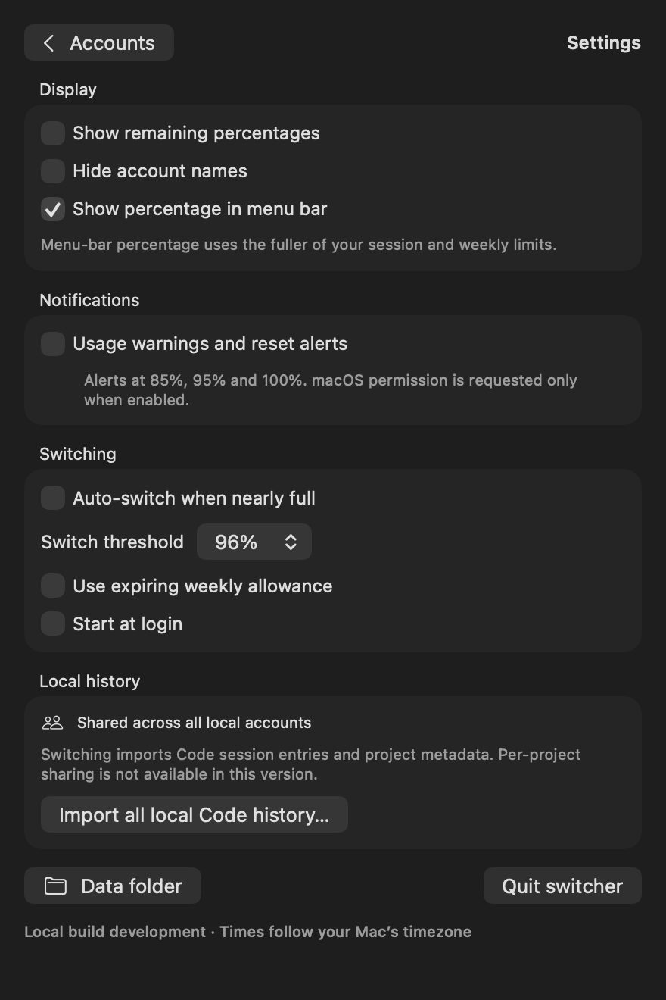

# Native macOS overview (draft)

An opt-in SwiftUI/AppKit interface for the existing Go backend. It shows account
cards, separate session/weekly bars, local 12-hour reset times, countdowns,
freshness and connection errors, settings, and optional usage notifications.
The panel anchors below the menu-bar item, scrolls within the visible display,
and dismisses on outside clicks, Escape, and display/Space changes.

## Preview

These images are rendered from the actual SwiftUI views using synthetic accounts.
They contain no saved sign-ins or personal account data.

| Account overview | Settings |
| --- | --- |
|  |  |

## Build and validate

Requires macOS 13+, Go 1.26+, and Xcode Command Line Tools. Uses Apple system
frameworks; no new Go or third-party UI dependencies.

```bash
bash native/build-app.sh
# Optional universal app (requires both architectures' toolchain support):
ARCHS="arm64 x86_64" bash native/build-app.sh "dist/Universal Switcher.app"

go vet ./...
go test ./...
"dist/Claude Account Switcher.app/Contents/MacOS/switcher-panel" --test-layout
```

The script builds and ad-hoc signs a new app bundle; it refuses to overwrite an
existing output. It does not install, launch, or change your Claude data. Without
the sibling helper, the Go executable keeps its existing tray interface. Windows
always uses that interface.

To regenerate the sample images on a Mac with a graphical session:

```bash
"dist/Claude Account Switcher.app/Contents/MacOS/switcher-panel" --render assets/native-macos-overview.png
"dist/Claude Account Switcher.app/Contents/MacOS/switcher-panel" --render assets/native-macos-settings.png --settings
"dist/Claude Account Switcher.app/Contents/MacOS/switcher-panel" --render /tmp/native-short.png --short-screen
```

The renderer uses an isolated temporary preferences suite and does not open the
backend or read Claude's account files. It renders its own view, not the desktop.

## Privacy and behavior

Only display metadata crosses anonymous child-process pipes. OAuth tokens,
cookies, and credentials stay in the existing Go backend. The Swift helper has
no network client. Actions are selected from an explicit backend allowlist.
Refresh preserves the last successful timestamp and respects server backoff.
Accounts with refresh failures cannot become automatic-switch destinations.

Hide-names mode hides account names in the panel, tooltip, and notification
text. Notifications start disabled and request macOS permission only when enabled.
Mouse monitors observe only clicks while the panel is visible; they do not log
or consume clicks in other applications. Keyboard monitoring is local to the app.
Switch/import/add actions require confirmation because they restart Claude.
The UI explicitly labels the existing sharing of local Code history across accounts.

## Draft integration points

The legacy executable/release workflow remains available. This draft adds a
reproducible bundle build rather than publishing a new release asset. Bundle
release packaging, signing/notarization policy, Intel runtime testing, and full
interactive UI QA need maintainer review before enabling this interface in
distributed releases. Native update notices open the release page because the
existing single-binary updater cannot update the companion helper atomically.
Banked reset-credit lookup/redemption is outside this PR.
